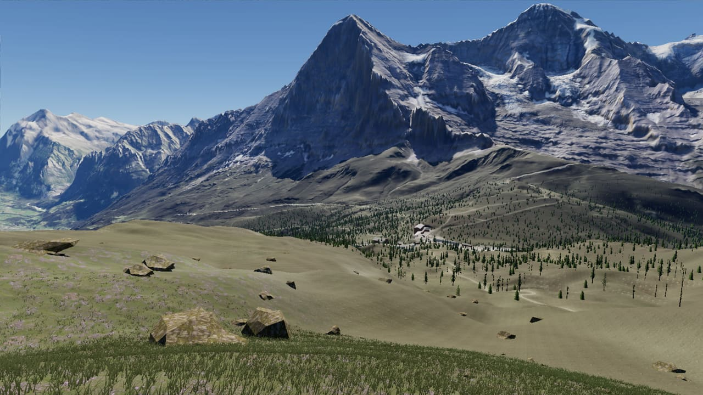
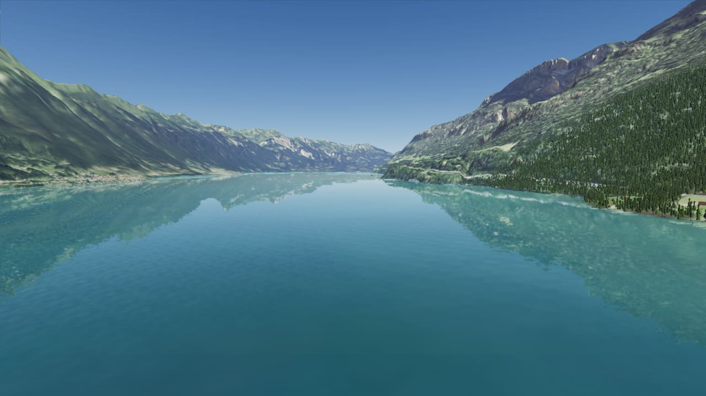
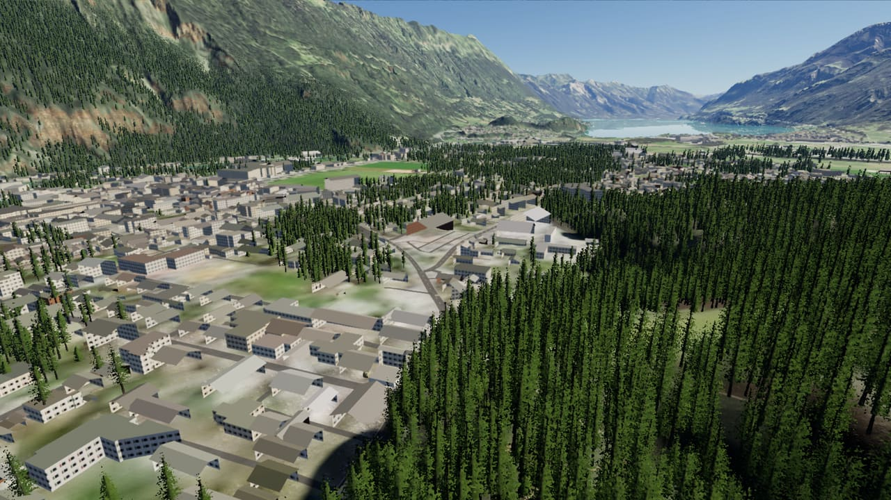

# Mini Open World

A realistic mountain open world in the browser — the real **Jungfrau, Lauterbrunnen and Lake Brienz** region
(Switzerland) — rendered with **three.js WebGPU** at **100+ frames per second on a MacBook Air M4**.
Walk around on foot, take off in a plane from Interlaken airfield, tune everything from a side panel, and edit the
world with the mouse or through commands (designed so that an AI agent can modify it on its own).



| | |
|---|---|
|  |  |
|  |  |


## What's inside

- **Real terrain**: 24.6 km × 24.6 km at 3 m detail (swissALTI3D) + 82 km of horizon (Copernicus), CDLOD terrain
  with geomorphing (no popping), PBR textures blended from land cover derived from the orthophotos.
- **Sky and light**: physically based atmosphere (Hillaire), day/night cycle (sun, moon, stars), perceptual exposure,
  volumetric clouds, mountain shadows all the way to the horizon, near cascaded shadows, global illumination (baked
  sky occlusion + light bounced off the terrain), terrain reflections in the lakes, bloom, lens flare.
- **Vegetation**: tens of thousands of procedural conifers (meshes up close, octahedral impostors in the distance,
  dithered transitions), grass and rocks generated on the GPU.
- **Inhabited world**: ~24,000 buildings and 2,165 km of roads and trails from OpenStreetMap, the Interlaken airfield
  runway, lit windows at night.
- **Play**: free camera, walking (collisions with trees, rocks, buildings), Cessna-like plane (semi-realistic flight
  model, chase or cockpit view), procedural sound (wind, engine, footsteps, cow bells).
- **Edit**: side panel (F1, ~120 settings) and world editor (chalets, fir trees, rocks, trail signposts, benches)
  saved to `world/props.json`.
- **Performance**: a governor adapts the internal resolution, then the level of detail, to hold ≤ 10 ms per frame,
  including when the fanless MacBook Air heats up.

## Getting started

Requirements: a recent **Chrome** (WebGPU), Node.js 20+, ~2 GB of disk space for the data.

```bash
npm install
npm run data   # downloads the geographic data (~1.1 GB) then builds public/data (~0.6 GB) — once
npm run dev    # http://localhost:5173
```

The data is not versioned: `npm run data` downloads it (swisstopo, Copernicus, OpenStreetMap, Poly Haven, ambientCG)
and prepares it. Downloads already present are skipped.

**Controls**: `1` free camera (WASD/ZQSD, right click to look, wheel for speed) · `2` walk · `3` plane (`V` switches
the view) · `F1` settings panel. The world editor is in the "World editor" section of the panel (left click in free
camera to place or remove).

`npm run uncapped` opens a Chrome window without the 60 Hz cap to see the real frame rate.

## Tools (for humans and agents)

- `node tools/agent.mjs <command>` drives the app open in the browser (`help` lists the commands: settings, camera,
  screenshots, world objects, plane, benchmark…).
- `node tools/run.mjs '<command>' …` does the same in a headless Chrome (screenshots, diagnostics).
- `node tools/bench.mjs` measures performance along 4 camera paths.
- `node tools/acceptance.mjs` automatically checks every feature and the performance
  (report: [docs/ACCEPTANCE.md](docs/ACCEPTANCE.md), history: [docs/ACCEPTANCE-HISTORY.md](docs/ACCEPTANCE-HISTORY.md)).

Architecture and performance notes: [CLAUDE.md](CLAUDE.md) · plan and decisions: [docs/PLAN.md](docs/PLAN.md).

## Data and credits

- Terrain and orthophotos © [swisstopo](https://www.swisstopo.admin.ch) (open government data, OGD).
- Copernicus DEM GLO-30 © DLR e.V. 2010-2014 and © Airbus Defence and Space GmbH 2014-2018, provided under
  COPERNICUS by the European Union and ESA.
- Buildings, roads and trails © [OpenStreetMap](https://www.openstreetmap.org/copyright) contributors (ODbL).
- Textures from [Poly Haven](https://polyhaven.com) and [ambientCG](https://ambientcg.com) (CC0).
- Rendering: [three.js](https://threejs.org); panel: [Tweakpane](https://tweakpane.github.io/docs/).
