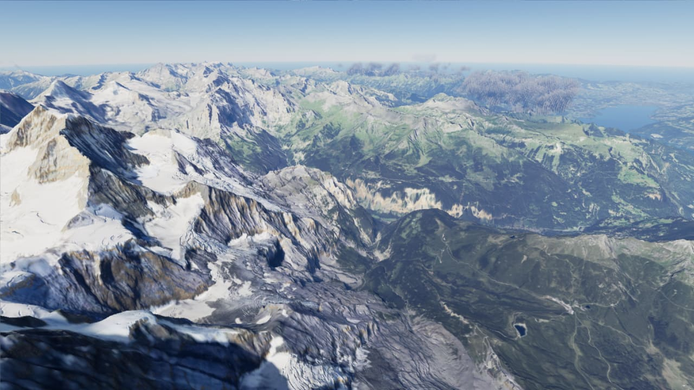
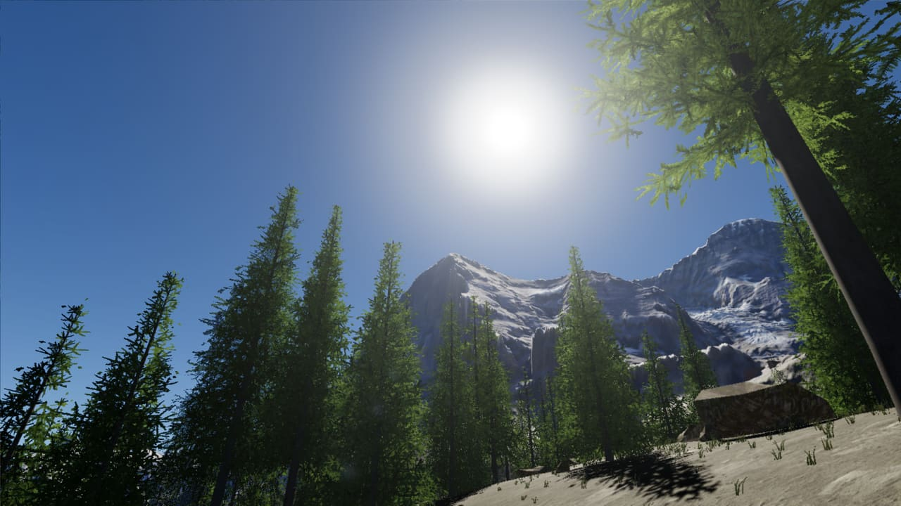
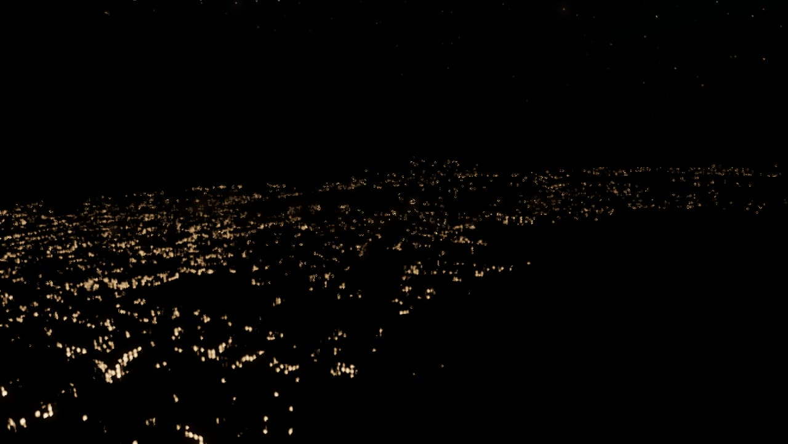

# Mini Open World

Un monde ouvert de montagne réaliste dans le navigateur — la vraie région de la **Jungfrau, Lauterbrunnen et du lac
de Brienz** (Suisse) — rendu avec **three.js WebGPU** à **100+ images/seconde sur un MacBook Air M4**.
On s'y promène à pied, on décolle en avion de l'aérodrome d'Interlaken, on règle tout depuis un panneau latéral, et on
peut éditer le monde à la souris ou par des commandes (pensées pour qu'un agent IA puisse le modifier en autonomie).


| | |
|---|---|
|  |  |
|  |  |



## Ce qu'il y a dedans

- **Relief réel** : 24,6 km × 24,6 km au détail de 3 m (swissALTI3D) + 82 km d'horizon (Copernicus), terrain CDLOD
  avec morphing (aucun « pop »), textures PBR mélangées selon l'occupation du sol déduite des orthophotos.
- **Ciel et lumière** : atmosphère physique (Hillaire), cycle jour/nuit (soleil, lune, étoiles), exposition
  perceptive, nuages volumétriques, ombres des montagnes jusqu'à l'horizon, ombres proches en cascades, illumination
  globale (occlusion du ciel précalculée + lumière réfléchie par le relief), reflets du relief dans les lacs, bloom,
  lens flare.
- **Végétation** : des dizaines de milliers de conifères procéduraux (maillages de près, imposteurs octaédriques au
  loin, transitions tramées), herbe et rochers générés sur le GPU.
- **Monde habité** : ~24 000 bâtiments et 2 165 km de routes et sentiers issus d'OpenStreetMap, piste de l'aérodrome
  d'Interlaken, fenêtres éclairées la nuit.
- **Jouer** : caméra libre, marche à pied (collisions avec arbres, rochers, bâtiments), avion type Cessna (modèle de
  vol semi-réaliste, vue poursuite ou cockpit), son procédural (vent, moteur, pas, cloches des vaches).
- **Éditer** : panneau latéral (F1, ~120 réglages) et éditeur du monde (chalets, sapins, rochers, panneaux de
  randonnée, bancs) enregistré dans `world/props.json`.
- **Performance** : un gouverneur adapte la résolution interne puis le niveau de détail pour tenir ≤ 10 ms par image,
  y compris quand le MacBook Air (sans ventilateur) chauffe.

## Démarrer

Prérequis : **Chrome** récent (WebGPU), Node.js 20+, ~2 Go d'espace disque pour les données.

```bash
npm install
npm run data   # télécharge les données géographiques (~1,1 Go) puis construit public/data (~0,6 Go) — une fois
npm run dev    # http://localhost:5173
```

Les données ne sont pas versionnées : `npm run data` les télécharge (swisstopo, Copernicus, OpenStreetMap, Poly Haven,
ambientCG) et les prépare. Les téléchargements déjà présents sont ignorés.

**Commandes** : `1` caméra libre (ZQSD/WASD, clic droit pour regarder, molette pour la vitesse) · `2` marche ·
`3` avion (`V` change de vue) · `F1` panneau de réglages. L'éditeur du monde est dans la section « Éditeur du monde »
du panneau (clic gauche en caméra libre pour placer ou supprimer).

`npm run uncapped` ouvre une fenêtre Chrome sans limite à 60 Hz pour voir le vrai nombre d'images par seconde.

## Outils (pour les humains et les agents)

- `node tools/agent.mjs <commande>` pilote l'application ouverte dans le navigateur (`help` liste les commandes :
  réglages, caméra, captures d'écran, objets du monde, avion, benchmark…).
- `node tools/run.mjs '<commande>' …` fait la même chose dans un Chrome invisible (captures, diagnostics).
- `node tools/bench.mjs` mesure les performances sur 4 parcours de caméra.
- `node tools/acceptance.mjs` vérifie automatiquement chaque fonctionnalité et la performance
  (rapport : [docs/ACCEPTANCE.md](docs/ACCEPTANCE.md), historique : [docs/ACCEPTANCE-HISTORY.md](docs/ACCEPTANCE-HISTORY.md)).

Notes d'architecture et de performance : [CLAUDE.md](CLAUDE.md) · plan et décisions : [docs/PLAN.md](docs/PLAN.md).

## Données et crédits

- Relief et orthophotos © [swisstopo](https://www.swisstopo.admin.ch) (données ouvertes, OGD).
- Copernicus DEM GLO-30 © DLR e.V. 2010-2014 et © Airbus Defence and Space GmbH 2014-2018, fourni dans le cadre de
  COPERNICUS par l'Union européenne et l'ESA.
- Bâtiments, routes et sentiers © les contributeurs [OpenStreetMap](https://www.openstreetmap.org/copyright) (ODbL).
- Textures [Poly Haven](https://polyhaven.com) et [ambientCG](https://ambientcg.com) (CC0).
- Rendu : [three.js](https://threejs.org) ; panneau : [Tweakpane](https://tweakpane.github.io/docs/).
